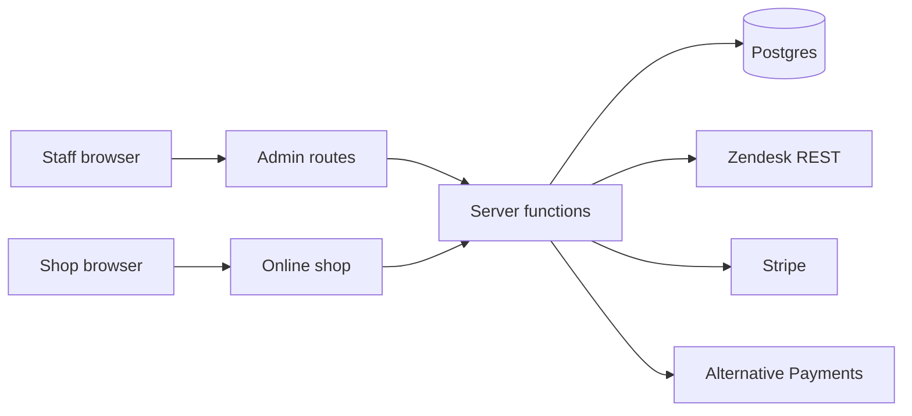
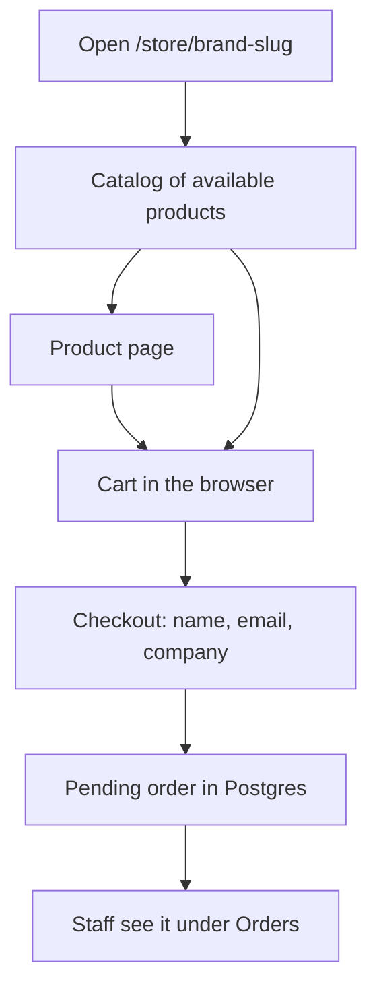
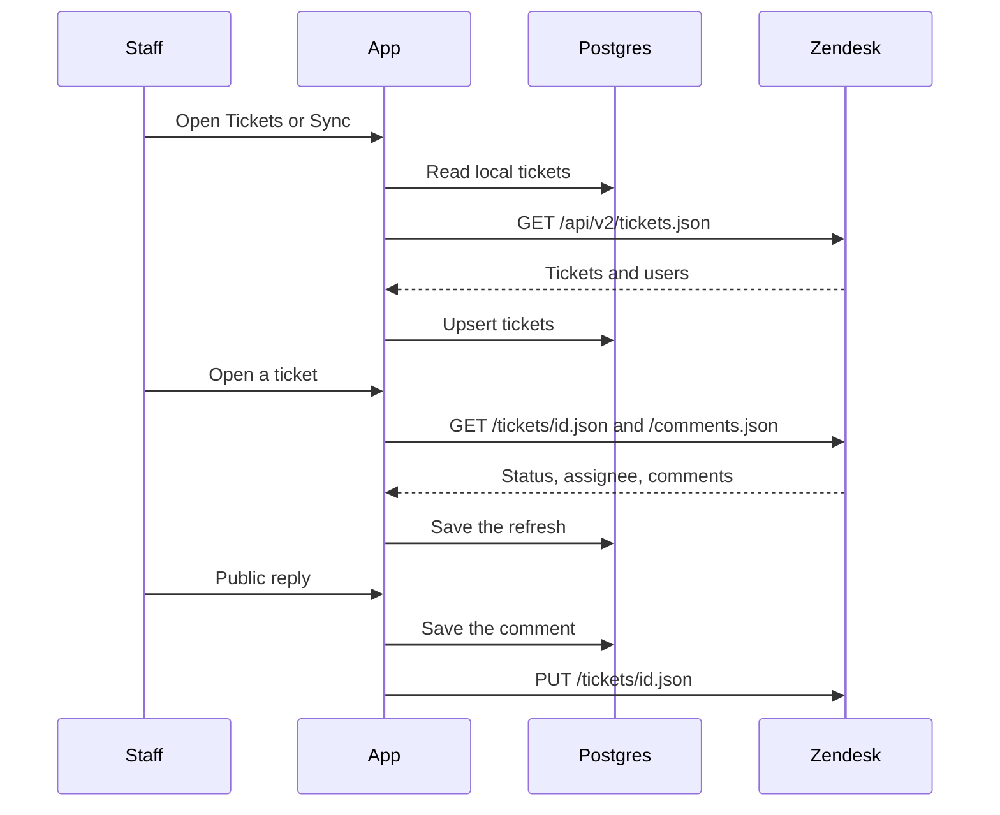
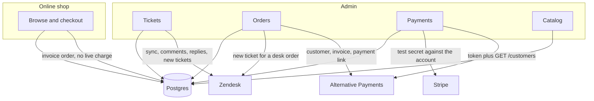

# Manage Tech Service

Admin portal and public online shop for an IT service desk. Staff run companies, people, the product catalog, orders, and support tickets. Customers browse the shop at `/store/manage-tech-service`. Zendesk stays the system of record for tickets when credentials are set. Card payments go through Stripe. Alternative Payments covers hosted checkout, including a sandbox.

## What you can do

| Area | Route | Who |
|---|---|---|
| Sign in | `/login` | Staff. Google, Microsoft, or email. |
| Dashboard | `/` | Staff |
| Tickets | `/tickets` | Staff. Local queue, synced with Zendesk when connected. |
| Companies | `/organizations` | Staff |
| People | `/users` | Staff |
| Catalog | `/products` | Staff. Products, photos, Excel import. |
| Orders | `/orders` | Staff |
| Payments | `/payments` | Staff. Card, invoice, purchase order, Alternative Payments. |
| Ticket forms | `/forms` | Staff |
| Roles | `/roles` | Staff |
| Zendesk | `/integrations` | Staff |
| Settings | `/settings` | Staff |
| Online shop | `/store/manage-tech-service` | Anyone. Eye icon in the sidebar opens it in a new tab. |

The shop slug comes from the brand name in Settings. `Manage Tech Service` becomes `manage-tech-service`.

## Run it

```bash
npm install
cp sample.env .env
npm run dev
```

The app listens on port `8080`. With no `DATABASE_URL`, data lives in an embedded Postgres (PGLite) and the seed migrations load sample companies, people, products, and tickets.

```bash
npm run typecheck
npm test
npm run build
```

## Environment

Copy [sample.env](sample.env) to `.env`. Anything set in the environment overrides the same value saved in the admin screens.

| Variable | Required | Used for |
|---|---|---|
| `DATABASE_URL` | No | Postgres connection. Unset uses PGLite. |
| `VITE_AUTH_ENABLED` | No | `false` turns sign-in off and uses the dev user. |
| `BETTER_AUTH_SECRET` | Deployed | Session signing secret. |
| `BETTER_AUTH_URL` | Deployed | Public origin of this app. |
| `GROK_AUTH_CLIENT_ID` | Deployed | Broker client for Google and Microsoft. |
| `GROK_AUTH_CLIENT_SECRET` | Deployed | Broker secret. |
| `GROK_AUTH_ISSUER` | No | Auth broker issuer. Has a default. |
| `ZENDESK_SUBDOMAIN` | To sync | Subdomain only, not the full host. |
| `ZENDESK_EMAIL` | To sync | Agent email that owns the API token. |
| `ZENDESK_API_TOKEN` | To sync | Zendesk API token. |
| `STRIPE_SECRET_KEY` | For cards | Stripe secret. `sk_` or `rk_`. |
| `STRIPE_PUBLISHABLE_KEY` | No | Stripe publishable key. `pk_`. |
| `ALTERNATIVE_CLIENT_ID` | For hosted pay | Alternative Payments client id. |
| `ALTERNATIVE_CLIENT_SECRET` | For hosted pay | Alternative Payments client secret. |
| `ALTERNATIVE_ENV` | No | `sandbox` (default) or `live`. |
| `ALTERNATIVE_API_BASE` | No | Override the Alternative Payments API host. |

Accepted aliases: `ZENDESK_HOST`, `ZENDESK_AGENT_EMAIL`, `ZENDESK_TOKEN`, `ZENDESK_API_KEY`, `STRIPE_API_KEY`, `ALTERNATIVE_PAYMENTS_CLIENT_ID`, `ALTERNATIVE_PAYMENTS_CLIENT_SECRET`, `ALTERNATIVE_ENVIRONMENT`.

When Zendesk, Stripe, or Alternative Payments credentials are present, the next visit to Zendesk or Payments checks the connection and stores the status. You do not have to paste the keys into the form.

## Data flow

Staff and shoppers never talk to Zendesk, Stripe, or Alternative Payments from the browser. Server functions read and write Postgres, then call those APIs with the server-side credentials.



On Vercel, auth, the portal, shop orders, and uploaded product photos all live in Neon. The app reads `DATABASE_URL`, and also the Vercel Postgres names `POSTGRES_URL` and `POSTGRES_PRISMA_URL`. Schema updates during deploy use `DATABASE_URL_UNPOOLED` or `POSTGRES_URL_NON_POOLING` when those are set, so the Neon pooler is not asked to run migrations. `channel_binding` is ignored because the Postgres driver does not support it. Product photos are stored in the database, not on the server disk, so a new deploy does not drop them.

## User-facing shop

The sidebar item **Online Shop** uses an eye icon and opens `/store/<brand-slug>` in a new tab. That route is public. It is not inside the admin shell and does not require sign-in.



The cart stays in `localStorage` until checkout. Checkout follows the same three steps as a typical Shopify checkout: contact, shipping address and method, then payment. Standard shipping is free over $500, otherwise $15. Express is $25. A shopper can create an account during checkout.

The account page is `/store/<slug>/account`. It is separate from staff sign-in. From there a customer sees their profile, each order, and the shipment: not shipped, shipped, out for delivery, or delivered, plus the tracking number when the desk adds one.

If the catalog is turned off in Settings, the shop stays up and shows that the catalog is hidden.

## Zendesk and the other integrations

Zendesk credentials are read from the environment first, then from the Zendesk screen. A connected account can test itself with `GET /users/me.json`.



Orders and some ticket actions also `POST /api/v2/tickets.json` so a portal event shows up in Zendesk. Calls use the agent email and API token as HTTP Basic auth (`email/token:api_token`). A `429` is retried once. The token is not written into error text.



Alternative Payments:

- `ALTERNATIVE_ENV=sandbox` uses `https://public-api.demo.alternativepayments.io`.
- `ALTERNATIVE_ENV=live` uses `https://public-api.alternativepayments.io`.
- Connecting checks `POST /oauth/token` and `GET /customers?limit=1`.
- An order with that payment method creates a customer, an invoice, and a payment link. If the invoice call fails, it falls back to `POST /payments/request`.
- **Check payment** on the order reads the invoice or the payment request.

Stripe is limited to verifying the secret against `GET /v1/account` and turning card payments on. This app does not charge a card itself.

Invoice and purchase order never call an outside API. A purchase order can require the letters `PO` in the order notes.

## Auth

`/login` is two columns. Google and Microsoft go through the auth broker (`grok-google`, `grok-microsoft`). Email and password are stored in this app's database. Set `VITE_AUTH_ENABLED=false` only for local work without a broker. Do not deploy with auth disabled.

## Project layout

```
src/routes/_app/     Admin pages, behind sign-in
src/routes/store/    Public shop
src/routes/login.tsx Sign-in
src/lib/portal/      Server functions, Zendesk, payments, shop cart
src/lib/auth/        Better Auth, Google, Microsoft, email
src/lib/db.ts        Neon or PGLite
migrations/          SQL applied in filename order
public/catalog/      Product photos
sample.env           Environment template
```

## Roles

Staff roles are owner, admin, agent, and viewer. Owners and admins change settings, payments, and staff. Agents can work tickets and orders. Viewers can read. Customer permissions are separate: a person either can order products or they cannot, and a company can turn catalog ordering off.
